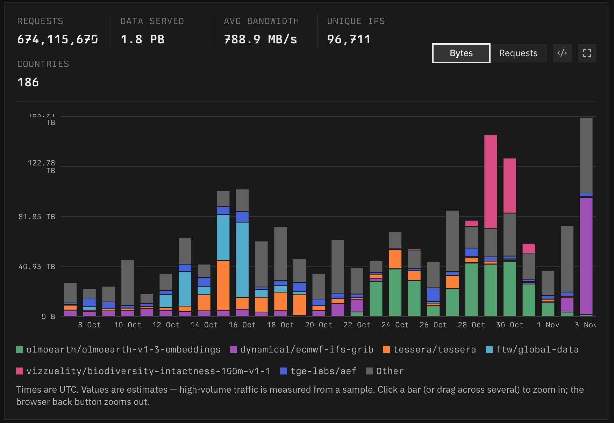
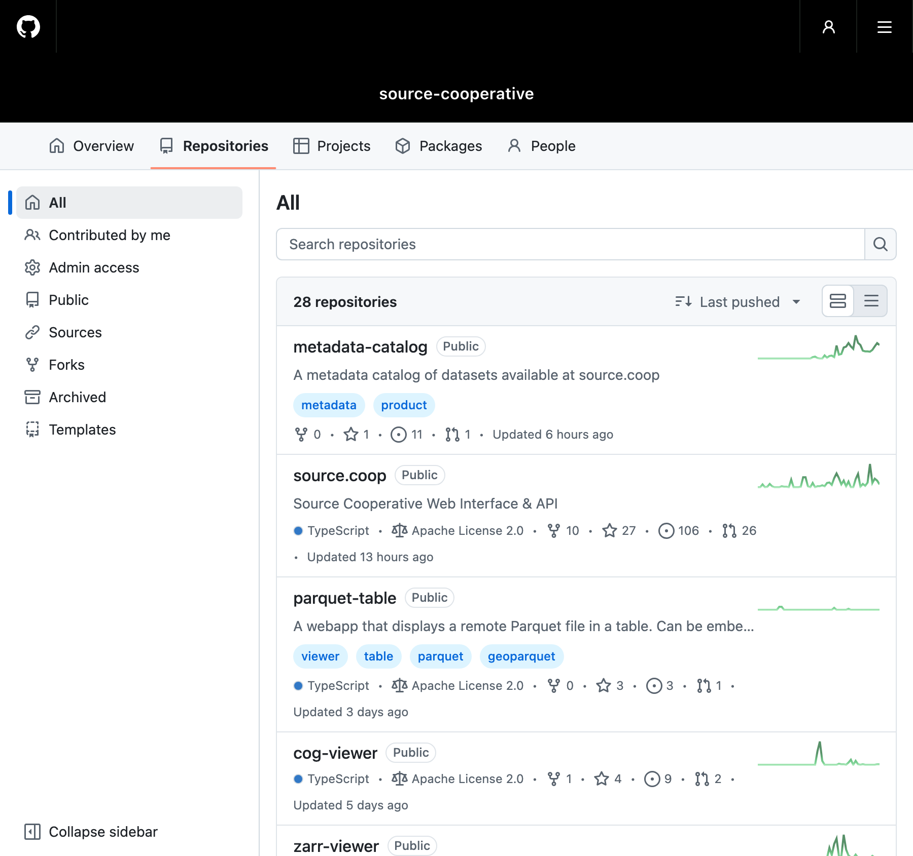
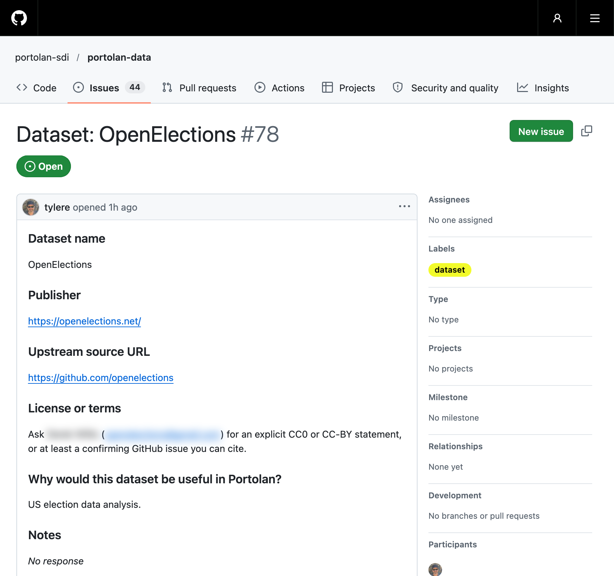

<div class="grid grid-cols-[1fr_1.1fr] gap-8 h-full items-center">
<div>

<SourceLogo class="w-56 mb-10" style="color: #EFEBEA" />

<p class="eyebrow">FOSS4G NA 2026</p>

# Source Cooperative: <span class="whitespace-nowrap">cloud-native</span> geospatial data publishing at any scale

<p class="muted">Tyler Erickson · CTO, Radiant Earth<br>Nov 4, 2026</p>

</div>

<LiveDemo
  class="globe h-110 aspect-square mx-auto"
  src="https://ui.source.coop/iframe.html?id=features-home-liveglobe--live-traffic&viewMode=story&globals=appearance%3Adark"
  :bar="false"
  :crop="40"
  :scale="0.7"
  :lazy="false"
/>

</div>

<style>
/* The globe story paints #111111; `lighten` takes the per-channel max with the
   Ink slide behind it, so the backdrop becomes exactly #121A1B and the globe is untouched. */
.globe { mix-blend-mode: lighten; }
</style>

<!--
The globe is live: each arc is a real request hitting data.source.coop right now.
-->

---

# Introductions

<div class="person">
  <div class="fact name"><span>Name</span>Tyler Erickson</div>
  <div class="fact"><span>Location</span>Los Altos, California, USA</div>
  <div class="fact"><span>Organization</span>Radiant Earth</div>
  <div class="fact"><span>Role</span>Chief Technology Officer</div></div>

<style>
.person { margin-top: 2.5rem; display: flex; flex-direction: column; gap: 1.2rem; }
.person .name { font-family: var(--src-mono); font-size: 2.6rem; line-height: 1.1; margin-bottom: .5rem; }
.person .fact { font-size: 1.3rem; line-height: 1.4; }
.person .fact span {
  display: block; margin-bottom: .3rem; color: var(--src-mute-on-dark);
  font-family: var(--src-mono); font-size: .7rem; text-transform: uppercase; letter-spacing: .06em;
}
</style>

<!--
TODO: add a background line if wanted.
-->

---

<p class="eyebrow">Credits</p>

# Thank yous

<div class="grid grid-cols-[1fr_1.4fr] gap-8 h-90">
<div>

- **Radiant Earth contributors**
- **Anthony Lukach** — many of these slides are adapted from his CNG Forum 2026 talk, *Building Source Cooperative*
- **Radiant Earth Technology Fellows**
- **Source users**

</div>

<LiveDemo src="https://alukach.com/slides-2026-cng-building-source-cooperative/" url />

</div>

<!--
Thank Anthony up front. The architecture, STS, viewer, BYOB and analytics slides are his, recoloured.
-->

---

<p class="eyebrow">Radiant Earth</p>

# Two ways Radiant Earth supports <span class="whitespace-nowrap">cloud-native</span> geospatial

<div class="grid grid-cols-2 gap-6 mt-8">
<div class="card">

<p class="eyebrow">Community</p>

### <span class="whitespace-nowrap">Cloud-Native</span> Geospatial Forum

<p class="muted">Practitioners converging on shared formats and practices.</p>

<div v-click class="stagger">

- In-person events and development sprints
- Webinars and meetings
- Blog and newsletter
- Members' Slack
- Fiscal sponsorship for community projects

</div>

</div>
<div class="card">

<p class="eyebrow">Infrastructure</p>

### Source Cooperative

<p class="muted">A durable home for publishing data products.</p>

<!-- Hidden for now:
- A data publishing service we build and operate
- Vendor-neutral, open source
- For data of any kind, at any scale
-->

</div>
</div>

<style>
/* One click reveals the list; the bullets then fade in one at a time on their own. */
.stagger:not(.slidev-vclick-hidden) li { animation: stagger-in .4s ease-out both; }
.stagger li:nth-child(1) { animation-delay: .3s; }
.stagger li:nth-child(2) { animation-delay: .9s; }
.stagger li:nth-child(3) { animation-delay: 1.5s; }
.stagger li:nth-child(4) { animation-delay: 2.1s; }
.stagger li:nth-child(5) { animation-delay: 2.7s; }
@keyframes stagger-in { from { opacity: 0; transform: translateY(4px); } to { opacity: 1; transform: none; } }
</style>

---
hideLogomark: true
---

<div class="w-[36%]">

<p class="eyebrow">The problem</p>

# <span class="whitespace-nowrap">Cloud-native</span> formats tackle the *how*.

Read just what you need, in place, over HTTP. No download-everything-first.

<div class="formats">
  <span>COG</span><span>Zarr</span><span>GeoParquet</span><span>STAC</span>
  <span>COPC</span><span>FlatGeobuf</span><span>PMTiles</span>
</div>

</div>

<div class="absolute inset-y-0 right-0 w-[60%]">
<LiveDemo class="h-full" src="/schedule-cloud-native.html" :scale="0.55" />
</div>

<style>
.formats { display: flex; flex-wrap: wrap; gap: .5rem; margin-top: 1.5rem; }
.formats span {
  font-family: var(--src-mono); font-size: .9rem; padding: .3rem .7rem;
  border: 1px solid var(--src-line-dark); border-radius: 3px; background: var(--src-ink-2);
}
</style>

<!--
The FOSS4G NA schedule, filtered to the Cloud-Native Geo & Data Infrastructure track: 46 sessions.
This is a cached snapshot (public/schedule-cloud-native.html). Refresh it with `pnpm cache-schedule`.
-->

---

<p class="eyebrow">Accessible</p>

# Plain HTTP. Read only what you need.

<div class="grid grid-cols-[1fr_1.6fr] gap-8 mt-4">
<div>

- Data is reachable over plain HTTP(S), or as S3 through `data.source.coop`
- Metadata is kept separate from the data
- Clients read only the bytes they need — no bespoke tooling

<p class="muted mt-6">Counting 1.65M rows in a 3.8 GB GeoParquet file takes about 1.6 s: DuckDB reads only the footer.</p>

</div>
<div>

```sql
-- DuckDB, straight over HTTPS
SELECT count(*)
FROM 'https://data.source.coop/giswqs/nwi/wetlands/AK_Wetlands.parquet';
-- 1649192

SELECT WETLAND_TYPE, round(sum(ACRES)) AS acres
FROM 'https://data.source.coop/giswqs/nwi/wetlands/DC_Wetlands.parquet'
GROUP BY 1 ORDER BY 2 DESC;
```

```bash
# Or any S3 tool, anonymously
aws s3 ls --no-sign-request \
  --endpoint-url https://data.source.coop \
  s3://giswqs/nwi/wetlands/
```

</div>
</div>

<!--
Both commands were run against the live service while drafting (Oct 26, 2026). The timing is from a home connection; re-run before the talk.
-->

---

<p class="eyebrow">The problem</p>

# <span class="whitespace-nowrap">Cloud-native</span> formats tackle the *how*. <span class="where-pause">What about the *where*?</span>

<div class="grid grid-cols-2 gap-10 mt-6">
<div class="after-pause">

Storing data in the cloud doesn't, on its own, solve geospatial's data problems.

- **Where** do I find it?
- Can I **reach** it reliably?
- Will it **still be there**, and still be well governed, next year?

<p class="muted">Too often the answer is a one-off bucket, a bespoke API, or one vendor's walled garden.</p>

</div>
<div v-click class="flex items-center justify-center">
  <SourceLogo class="w-90" style="color: #EFEBEA" />
</div>
</div>

<style>
/* "What about the where?" fades in on its own, a pause after the slide opens. */
.where-pause { animation: after-pause-in .5s ease-out 1s both; }
/* Then the text fades in on its own, a pause after the question. */
.after-pause { animation: after-pause-in .5s ease-out 2.7s both; }
@keyframes after-pause-in { from { opacity: 0; } to { opacity: 1; } }
</style>

<!--
Paraphrasing the Cloud-Native Geospatial guide: cloud storage alone doesn't solve the data problem.
-->

---

# What is Source Cooperative?

<p class="maps-to">A service to put <span class="pair"><span>files</span><i v-click="1">&darr;</i><em v-click="1">objects</em></span> on <span class="pair"><span>the internet</span><i v-click="1">&darr;</i><em v-click="1">object storage</em></span>.</p>

<style>
.maps-to { margin-top: 2.5rem; font-family: var(--src-mono); font-size: 2rem; line-height: 1.3; }
.maps-to .pair { display: inline-flex; flex-direction: column; align-items: center; vertical-align: top; }
.maps-to .pair i, .maps-to .pair em { font-style: normal; font-size: .7em; line-height: 1.3; color: var(--src-mute-on-dark); }
</style>

---
layout: center
---

<blockquote class="pull">
  “Data practitioners should never log into the AWS Console.”
  <cite>Jed Sundwall<span>Executive Director, Radiant Earth</span></cite>
</blockquote>

<style>
.pull {
  margin: 0 !important; padding: 2.5rem 3rem !important; max-width: 54rem;
  font-size: 3rem; line-height: 1.2; font-style: italic;
}
.pull cite {
  display: block; margin-top: 1.5rem; font-style: normal; color: var(--src-mute-on-dark);
  font-family: var(--src-mono); font-size: .9rem; text-transform: uppercase; letter-spacing: .06em;
}
.pull cite span {
  display: block; margin-top: .35rem; text-transform: none; letter-spacing: 0;
  font-family: var(--src-sans); font-size: 1rem;
}
</style>

---
hideLogomark: true
---

<div class="w-[36%]">

<p class="eyebrow">Source Cooperative</p>

# Publish data of any kind, at any scale

- Format and domain agnostic
- On commodity object storage
- Across several cloud providers

</div>

<!-- The deck's dark color-scheme is inherited by embedded pages; pin them to light. -->
<div class="absolute inset-y-0 right-0 w-[60%]" style="color-scheme: light;">
<DemoReel class="h-full" :demos="[
  { label: 'source.coop', src: 'https://source.coop/', scale: 0.5 },
  { label: 'Data.gov archive', src: 'https://source.coop/harvard-lil/gov-data', scale: 0.5 },
  { label: 'Smithsonian', src: 'https://source.coop/harvard-lil/smithsonian-open-access', scale: 0.5 },
]" />
</div>

---

<p class="eyebrow">About Source Cooperative</p>

# Source stats

<div class="stats">
  <h3>Curated to publish</h3>
  <div class="stat"><span>Storage</span><b>10.4 <small>PB</small></b><em>AWS S3 · via AWS Open Data Program</em></div>
  <div class="stat"><span>Storage</span><b>120 <small>TB</small></b><em>Azure Blob Storage · via AI for Earth</em></div>
  <h3>Open to consume</h3>
  <div class="stat"><span>Usage (bytes) · 28 days</span><b>1.8 <small>PB</small></b><em>egress through the data proxy</em></div>
  <div class="stat"><span>Usage (requests) · 28 days</span><b>674 <small>M</small></b><em>~279 per second, on average</em></div>
</div>

<p class="muted mt-4 text-sm">Anyone can read. Approved organizations publish — today, mostly scientific data publishers.</p>

<style>
.stats { margin-top: 1.25rem; display: grid; grid-template-columns: max-content repeat(2, minmax(0, 1fr)); gap: .75rem; align-items: center; }
.stats h3 { margin: 0; font-size: 1.1rem; line-height: 1.3; }
.stat {
  display: flex; flex-direction: column; gap: .35rem;
  background: var(--src-ink-2); border: 1px solid var(--src-line-dark); border-radius: 4px; padding: .9rem 1rem;
}
.stat span { color: var(--src-mute-on-dark); font-family: var(--src-mono); font-size: .62rem; text-transform: uppercase; letter-spacing: .06em; }
.stat b { font-family: var(--src-mono); font-size: 2rem; font-weight: 400; line-height: 1.05; letter-spacing: -.02em; }
.stat b small { font-size: 1rem; }
.stat em { font-style: normal; font-family: var(--src-mono); font-size: .6rem; line-height: 1.4; color: var(--src-mute-on-dark); }
</style>

<!--
Usage numbers: source.coop/admin/analytics, Oct 7 - Nov 3, 2026 (same as the next slide).
AWS storage: sum of total_bytes across the 629 registered products in source-cooperative/metadata-catalog (release catalog-2026-11-03, weekly S3 inventory). Another 0.77 PB sits in bucket prefixes with no product.
TODO: the Azure number is still from Anthony's CNG 2026 deck (early Oct 2026); the catalog covers only the AWS bucket.
-->

---
layout: full
---



<!--
Screenshot of source.coop/admin/analytics (groupBy=product, metric=bytes), taken Nov 3, 2026.
-->

---
hideLogomark: true
---

<div class="w-[36%]">

<p class="eyebrow">FAIR · Interoperable &amp; reusable</p>

# Built-in viewers for <span class="whitespace-nowrap">cloud-native</span> formats

- Source follows <span class="whitespace-nowrap">cloud-native</span> geospatial standards and guides publishers toward best practices
- Format and structure stay the publisher's choice
- Format-specific viewers let you see what's in a product before you write code

</div>

<div class="absolute inset-y-0 right-0 w-[60%]" style="color-scheme: light;">
<DemoReel class="h-full" :demos="[
  { label: 'Parquet', src: 'https://source.coop/giswqs/nwi/wetlands/AK_Wetlands.parquet', scale: 0.6 },
  { label: 'STAC',    src: 'https://source.coop/wildland-almanac/california/catalog.json', scale: 0.6 },
  { label: 'PMTiles', src: 'https://source.coop/protomaps/openstreetmap/v4.pmtiles', scale: 0.6 },
  { label: 'COG',     src: 'https://source.coop/ausantarctic/gebco/GEBCO_2025.tif' },
  { label: 'Zarr',    src: 'https://source.coop/dynamical/noaa-hrrr-forecast-48-hour/v0.1.0.zarr', scale: 0.6 },
]" />

</div>

<!--
Each of these is a dataset you could use in a demo tomorrow.
-->

---
hideLogomark: true
---

<div class="w-[36%]">

<p class="eyebrow">FAIR · Findable</p>

# Every product has a home you can find

- A **stable URL** per product
- Indexed by **Source Search** and **Google Dataset Search**
- Can carry a **DOI**
- Described in a self-describing, queryable **metadata catalog** — published as a product on Source itself

</div>

<div class="absolute inset-y-0 right-0 w-[60%]" style="color-scheme: light;">
<LiveDemo class="h-full" src="https://source.coop/source/metadata-catalog" :scale="0.5" url />
</div>

<!--
Metadata catalog product: https://source.coop/source/metadata-catalog
-->

---
layout: center
class: source-bone text-center
hideLogomark: true
hide: true
---

<p class="eyebrow">FAIR · Accessible</p>

# The data proxy

<p class="muted">data.source.coop</p>

---
clicks: 2
---

<p class="eyebrow">Accessible</p>

# Architecture

<ArchitectureDiagram :highlight="$clicks === 1 ? 'top' : $clicks === 2 ? 'bottom' : undefined" />

<!--
Two services: source.coop (Next.js UI + metadata API, backed by DynamoDB) and data.source.coop (the data proxy).
The proxy asks the source.coop API where a product's data lives, then reads/writes the object storage backend directly.
-->

---

<p class="eyebrow">Source Data Proxy</p>

# Fast everywhere, at the edge

<!-- Same flow position as the Architecture slide, so the bottom row lines up; bullets sit in the empty top area. -->
<div class="relative">
<ArchitectureDiagram bottom-only />
<div class="absolute inset-x-0 top-0">

- Written in Rust, compiled to WASM, running on Cloudflare Workers
- Serverless, no cold start
- Serves data close to the user, with HTTP/3
- `object_store` behind a reusable `multistore` layer

</div>
</div>

<!--
From Anthony's proxy-rewrite slides. Bursty traffic: 20 to 5000 RPS.
-->

---
hideLogomark: true
---

<div class="w-[36%]">

<p class="eyebrow">For publishers</p>

# Know who uses your data

Publishers want to know:

- How many people use my product?
- Where are they?
- Which parts are they reading?

<p class="muted mt-4">The proxy logs each request; analytics run on Cloudflare Workers Analytics Engine.</p>

</div>

<div class="absolute inset-y-0 right-0 w-[60%]" style="color-scheme: light;">
<DemoReel class="h-full" :demos="[
  { label: 'Summary', src: 'https://ui.source.coop/iframe.html?id=features-product-page-analytics-usagepanel--high-volume&viewMode=story&globals=appearance%3Alight', scale: 0.6 },
  { label: 'Detailed', src: 'https://ui.source.coop/iframe.html?id=features-product-page-analytics-productanalyticsview--default&viewMode=story&globals=appearance%3Alight', scale: 0.6 },
]" />
</div>

---
hideLogomark: true
---

<div class="w-[36%]">

<p class="eyebrow">Accessible</p>

# Bring your own bucket

- Register your own **S3**, **Azure** or **GCS** buckets
- Get Source's viewers, auth and analytics on data you already host
- The proxy sits in front of any S3-compatible storage, so the platform isn't captive to one vendor

</div>

<div class="absolute inset-y-0 right-0 w-[60%]" style="color-scheme: light;">
<DemoReel class="h-full" :demos="[
  { label: 'AWS S3', src: 'https://ui.source.coop/iframe.html?id=features-settings-data-connections-dataconnectionform--edit-with-stored-key&viewMode=story&globals=appearance%3Alight', scale: 0.6 },
  { label: 'Azure Blob Storage', src: 'https://ui.source.coop/iframe.html?id=features-settings-data-connections-dataconnectionform--azure&viewMode=story&globals=appearance%3Alight', scale: 0.6 },
  { label: 'GCS', src: 'https://ui.source.coop/iframe.html?id=features-settings-data-connections-dataconnectionform--google-cloud&viewMode=story&globals=appearance%3Alight', scale: 0.6 },
]" />
</div>

---

<p class="eyebrow">Security</p>

# No long-lived keys

<div class="grid grid-cols-[1fr_1.6fr] gap-8 mt-4">
<div>

- People read data with the cloud tooling they already use
- Short-lived, scoped credentials are brokered on the fly with **OIDC** and **STS**
- An STS-like endpoint at `data.source.coop/.sts`
- ID tokens can come from Source, GitHub, …

<p class="muted mt-4">Easy and safe by default.</p>

</div>
<div>

```yaml
# GitHub Actions: OIDC → temporary credentials
- name: Sign in to Source Cooperative as your-org--nightly-sync
  uses: aws-actions/configure-aws-credentials@v6
  with:
    role-to-assume: arn:aws:iam::your-org--nightly-sync:role/FullAccess
    audience: https://data.source.coop
    sts-endpoint: https://data.source.coop/.sts
    aws-region: us-west-2
```

</div>
</div>

---
hideLogomark: true
---

<div class="w-[36%]">

<p class="eyebrow">Open source</p>

# Source Cooperative is open source

The platform, the data proxy and the format viewers are developed in the open on GitHub.

<p class="mono text-sm mt-6"><a href="https://github.com/orgs/source-cooperative/repositories">github.com/source-cooperative</a></p>

</div>

<a class="absolute inset-y-0 right-0 w-[60%] block overflow-hidden rounded-l" style="border: 1px solid var(--src-line-dark); border-right: 0;" href="https://github.com/orgs/source-cooperative/repositories" target="_blank">
  
</a>

<!--
Screenshot of github.com/orgs/source-cooperative/repositories, taken Nov 4, 2026 (GitHub doesn't allow iframing).
-->

---
hideLogomark: true
---

<div class="w-[36%]">

<p class="eyebrow">Data conversion</p>

# Portolan

Convert traditional geospatial datasets into <span class="whitespace-nowrap">cloud-native</span> geospatial formats

<p class="muted">Project supported by Radiant Earth</p>

<div class="mono text-sm mt-6 flex flex-col gap-2">
  <a href="https://www.portolan-sdi.org/">portolan-sdi.org</a>
  <a href="https://github.com/portolan-sdi/portolan-data/issues"><span class="whitespace-nowrap">github.com/portolan-sdi/</span><wbr><span class="whitespace-nowrap">portolan-data/issues</span></a>
</div>

</div>

<div class="absolute inset-y-0 right-0 w-[60%]">
<LiveDemo class="h-full" src="https://www.portolan-sdi.org/" :scale="0.5" url />
</div>

---
hideLogomark: true
---

<div class="w-[36%]">

<p class="eyebrow">Portolan</p>

# Request a dataset

Open a GitHub issue naming the dataset, its publisher, source and license.

Example: **OpenElections**, US election results, requested for US election data analysis.

<p class="mono text-sm mt-6"><a href="https://github.com/portolan-sdi/portolan-data/issues/78">portolan-data/issues/78</a></p>

</div>

<a class="absolute inset-y-0 right-0 w-[60%] block overflow-hidden rounded-l" style="border: 1px solid var(--src-line-dark); border-right: 0;" href="https://github.com/portolan-sdi/portolan-data/issues/78" target="_blank">
  
</a>

<!--
Screenshot of github.com/portolan-sdi/portolan-data/issues/78, taken Nov 4, 2026 (GitHub doesn't allow iframing).
-->

---

<p class="eyebrow">Governance</p>

# Why choose Source?

<div class="grid grid-cols-3 gap-5 mt-8">
<div class="card">

### Nonprofit incentives

Operated by Radiant Earth, a nonprofit, for the long-term public interest.

</div>
<div class="card">

### Vendor-neutral

Commodity object storage across providers, behind one S3-compatible interface.

</div>
<div class="card">

### No lock-in

Open source software, open standard formats, stable URLs.

</div>
</div>

<p class="mt-8 text-lg">Governance decides whether large open datasets survive. That's why publishers and users can trust that the data will stay accessible and durable.</p>

---
hideLogomark: true
---

<div class="grid grid-cols-[1.7fr_1fr] gap-10 h-full items-center">
<div>

# Takeaways

<div class="takeaways">
  <div><h3>Data users</h3><p>Access more than 10 PB of public data products on Source Cooperative</p></div>
  <div><h3>Data producers</h3><p>Reach out if you want to publish new datasets</p></div>
  <div><h3>Portolan</h3><p>Convert traditional geospatial data to <span class="whitespace-nowrap">cloud-native</span> geospatial formats</p></div>
</div>

</div>
<div class="text-center">

<SourceLogo class="w-56 mx-auto mb-6" style="color: #EFEBEA" />

# Thank you

<p class="muted">Questions?</p>

<p class="mono"><a href="mailto:hello@source.coop">hello@source.coop</a></p>

<div class="flex justify-center mt-4">
  <DeckQRCode :size="120" />
</div>

<p class="muted text-sm mt-2">These slides</p>

</div>
</div>

<style>
.takeaways { margin-top: 1.25rem; display: flex; flex-direction: column; gap: .8rem; }
.takeaways > div {
  background: var(--src-ink-2); border: 1px solid var(--src-line-dark); border-left: 3px solid var(--src-bone);
  border-radius: 4px; padding: .75rem 1.25rem;
}
.takeaways h3 { margin: 0 0 .25rem; font-size: 1.15rem; line-height: 1.3; font-weight: 700; }
.takeaways p { margin: 0; font-size: 1.15rem; line-height: 1.35; }
</style>
